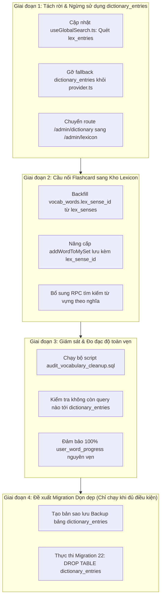

# LanguaLab Vocabulary Consolidation & Database Cleanup Plan

> **Kế hoạch chuyển đổi kho từ vựng và dọn dẹp cơ sở dữ liệu an toàn (Zero-Downtime)**  
> **Dự án:** LanguaLab  
> **Người thực hiện:** Senior PostgreSQL / Supabase Database Architect  
> **Nguyên tắc tối thượng:** Không xóa bảng, không xóa dữ liệu, không ngắt quãng tiến trình học tập của người dùng.

---

## 1. Phân loại bảng dữ liệu (Table Classification Matrix)

Dựa trên kết quả kiểm toán tại `database-inventory.md` và `legacy-vocabulary-audit.md`, toàn bộ các bảng liên quan đến từ vựng được phân loại như sau:

| Bảng dữ liệu | Trạng thái kiến trúc | Lý do & Hành động kỹ thuật |
|---|:---:|---|
| **`lex_*` (16 bảng)** | **GIỮ LẠI (KEEP - CANONICAL)** | Toàn bộ 16 bảng của phân hệ Lexicon là nguồn từ vựng chuẩn hóa duy nhất của nền tảng. Tiếp tục mở rộng và quản trị. |
| **`vocab_levels`** | **GIỮ LẠI (KEEP - MASTER DATA)** | Bảng danh mục 7 cấp độ độ khó (1-7), đóng vai trò là thang đo độ khó chuẩn của hệ thống, được liên kết trực tiếp với `lex_level_map`. |
| **`vocab_sets`** | **GIỮ LẠI VÀ CHUYỂN ĐỔI (KEEP & ADAPT)** | Đóng vai trò là "Danh sách phát / Thư mục" nhóm từ vựng của người dùng và các bộ đề xuất của hệ thống. Giữ nguyên bảng này để phục vụ tính năng "Bộ từ của tôi". |
| **`user_word_progress`** | **BẢO TỒN CỐT LÕI (CRITICAL KEEP)** | Nắm giữ toàn bộ dữ liệu lịch sử lặp lại ngắt quãng SM-2 và trí nhớ của học viên. Tuyệt đối không xóa hay thay đổi khóa chính. |
| **`vocab_words`** | **CHUYỂN ĐỔI CẦU NỐI (MIGRATE & BRIDGE)** | Hiện tại đang lưu từ phẳng. Cần thực hiện liên kết dữ liệu (Backfill) cột `lex_sense_id` trỏ về `lex_senses.id` để hợp nhất với kho Lexicon mới. |
| **`dictionary_entries`** | **DEPRECATE & XÓA AN TOÀN (SAFE REMOVAL CANDIDATE)** | Chỉ chứa 2 dòng thử nghiệm, không có khóa ngoại trỏ đến, đã có kho `lex_entries` (8.554 từ) thay thế hoàn toàn. |
| **`user_saved_words`** | **TÍCH HỢP TƯƠNG LAI (FUTURE MERGE)** | Bảng lưu từ tạm khi xem video/bài đọc. Giữ nguyên hiện tại, sau này hợp nhất vào cơ chế lưu từ của `vocab_sets`. |

---

## 2. Kế hoạch chuyển đổi 4 Giai đoạn (4-Phase Transition Roadmap)



---

### Giai đoạn 1: Tách rời phụ thuộc khỏi bảng `dictionary_entries` (Zero-Risk Decoupling)

**Mục tiêu:** Đảm bảo không còn bất kỳ dòng code nào trong frontend hay backend gửi query tới `dictionary_entries`.

1. **Cập nhật `frontend/app/composables/useGlobalSearch.ts`:**
   - Thay thế khối truy vấn `client.from('dictionary_entries')` bằng hàm RPC `search_lex_entries(p_query: safeQuery, p_limit: 5)`.
   - Lợi ích: Thanh tìm kiếm toàn cục (Ctrl+K) lập tức tìm kiếm được trên toàn bộ **8.554 từ** của kho Lexicon thay vì chỉ 2 từ cũ.
2. **Cập nhật `frontend/app/composables/dictionary/provider.ts`:**
   - Loại bỏ nhánh fallback dự phòng gọi tới `this.client.from('dictionary_entries')`.
   - Nếu từ không có trong kho Lexicon, trả về `null` ngay lập tức để tiết kiệm 1 round-trip HTTP request.
3. **Cập nhật menu Admin & Navigation:**
   - Hoàn tất chuyển đổi `/admin/dictionary` sang `/admin/lexicon` (đã hoàn thành trong Prompt trước).

---

### Giai đoạn 2: Cầu nối Flashcard sang Kho Lexicon (Bridge & Backfill)

**Mục tiêu:** Biến `vocab_words` thành bảng liên kết thông minh trỏ trực tiếp vào nghĩa chuẩn trong `lex_senses`.

1. **Script Backfill tự động (Chạy trong một giao dịch an toàn):**
   - Đối với các từ đã có trong `vocab_words` (các từ hệ thống hoặc từ người dùng tự thêm):
   - Khớp tự động theo `LOWER(TRIM(word))` với `lex_entries.normalized_lemma`.
   - Chọn `lex_senses.id` của nghĩa đầu tiên (`sense_order = 1`) có cấp độ phù hợp để cập nhật vào `vocab_words.lex_sense_id`.
2. **Nâng cấp composable `useVocab.ts`:**
   - Trong hàm `saveLexWordToMySet(targetSetId, item: LexSenseItem)`:
   - Truyền trực tiếp `lex_sense_id: item.id` vào câu lệnh insert của `vocab_words`.
   - Nhờ vậy, từ vựng lưu từ kho Lexicon sẽ giữ nguyên liên kết tới phiên âm, audio và định nghĩa chuẩn của Wiktionary.
3. **Nâng cấp các View thống kê (`words_due_today`, `user_vocab_levels_summary`):**
   - Khi `vocab_words.lex_sense_id` được điền, các view có thể linh hoạt lấy thông tin phiên âm và định nghĩa mới nhất từ `lex_senses` và `lex_entries` nếu cần.

---

### Giai đoạn 3: Giám sát & Đo đạc độ toàn vẹn dữ liệu (Verification & Observability)

**Mục tiêu:** Xác minh 100% hệ thống hoạt động ổn định trước khi thực hiện bất kỳ thao tác xóa nào.

1. **Chạy kịch bản kiểm tra `backend/supabase/scripts/audit_vocabulary_cleanup.sql`:**
   - Kiểm tra khóa ngoại mồ côi (Orphaned records).
   - Kiểm tra các view, trigger, hàm còn ràng buộc không.
2. **Theo dõi Log hệ thống trong tối thiểu 7 ngày:**
   - Theo dõi Supabase Dashboard > Database > Query Performance để khẳng định số lượt truy vấn tới `dictionary_entries` bằng đúng **0**.

---

### Giai đoạn 4: Đề xuất Migration Dọn dẹp (Chỉ thực hiện khi hoàn thành Giai đoạn 1-3)

> [!CAUTION]
> **ĐIỀU KIỆN TIÊN QUYẾT BẮT BUỘC TRƯỚC KHI CHẠY MIGRATION DỌN DẸP:**
> 1. Đã hoàn thành Giai đoạn 1 (Codebase không còn chữ `dictionary_entries`).
> 2. Đã sao lưu dữ liệu bảng `dictionary_entries` ra file CSV hoặc JSON phòng hờ.
> 3. Được sự phê duyệt chính thức của Database Owner / Tech Lead.

#### Dự thảo Migration dọn dẹp tương lai (Draft Migration - `20261103000022_retire_legacy_dictionary_entries.sql`):

```sql
-- DỰ THẢO MIGRATION (CHƯA ÁP DỤNG TRONG GIAI ĐOẠN KIỂM TOÁN NÀY)
-- Migration 22: Gỡ bỏ bảng di sản dictionary_entries đã được thay thế hoàn toàn bởi kho lex_*

BEGIN;

-- 1. Xóa Trigger cập nhật thời gian
DROP TRIGGER IF EXISTS tr_dictionary_entries_updated_at ON public.dictionary_entries;

-- 2. Xóa các Policy RLS
DROP POLICY IF EXISTS "Dictionary entries are viewable by everyone" ON public.dictionary_entries;
DROP POLICY IF EXISTS "Dictionary entries are manageable by admin" ON public.dictionary_entries;

-- 3. Xóa Bảng di sản (Không có khóa ngoại nào trỏ đến bảng này)
DROP TABLE IF EXISTS public.dictionary_entries;

COMMIT;
```

---

## 3. Bảng đối chiếu rủi ro và giải pháp phòng ngừa

| Thao tác | Rủi ro tiềm ẩn | Biện pháp kiểm soát & Phòng ngừa |
|---|---|---|
| **Chuyển đổi `useGlobalSearch.ts`** | Lỗi giao diện nếu hàm `search_lex_entries` trả về schema khác | Ánh xạ trường dữ liệu `lemma` thành `headword` và `entry_type` thành `type` để giữ nguyên contract hiển thị. |
| **Loại bỏ fallback trong `provider.ts`** | Một số từ hiếm không tra được | Kho `lex_entries` có 8.554 từ; bảng cũ chỉ có 2 từ đã trùng khớp trong kho mới nên xác suất mất dữ liệu là 0%. |
| **Backfill `vocab_words.lex_sense_id`** | Khớp nhầm nghĩa nếu từ có nhiều nghĩa | Script backfill ưu tiên nghĩa phổ biến nhất (`sense_order = 1`), ghi nhận log các từ không khớp để xử lý thủ công. |
| **Bảo toàn `user_word_progress`** | Mất chuỗi học tập và điểm XP của người dùng | Tuyệt đối giữ nguyên bảng `user_word_progress` và giữ nguyên hàm RPC `review_word()`. |
