# LanguaLab Database Dependency Matrix & Call Graph

> **Tài liệu phân tích ma trận phụ thuộc toàn diện cơ sở dữ liệu**  
> **Dự án:** LanguaLab (Giai đoạn 2: Hợp nhất Cơ sở Dữ liệu & Từ vựng)  
> **Thời điểm lập:** Tháng 11/2026  
> **Kiến trúc sư:** Senior Supabase / PostgreSQL Database Architect  
> **Phạm vi:** 71 Bảng dữ liệu, 8 Khung nhìn, 32 Hàm/RPC và toàn bộ mã nguồn Frontend/Backend.

---

## 1. Sơ đồ cây phụ thuộc phân cấp (Hierarchical Dependency Tree)

```mermaid
graph TD
    %% Base Level
    profiles[profiles: auth.users]
    vocab_levels[vocab_levels: 7 levels]
    lex_sources[lex_sources]

    %% Level 1 Dependencies
    lex_level_map[lex_level_map] -->|vocab_level_number RESTRICT| vocab_levels
    vocab_sets[vocab_sets] -->|user_id CASCADE| profiles
    vocab_sets -->|level_id SET NULL| vocab_levels

    lex_entries[lex_entries]
    lex_import_batches[lex_import_batches] -->|source_id SET NULL| lex_sources
    lex_raw_records[lex_raw_records] -->|batch_id CASCADE| lex_import_batches

    %% Level 2 Dependencies (Lexicon Core)
    lex_senses[lex_senses] -->|entry_id CASCADE| lex_entries
    lex_forms[lex_forms] -->|entry_id CASCADE| lex_entries
    lex_pronunciations[lex_pronunciations] -->|entry_id CASCADE| lex_entries
    lex_relations[lex_relations] -->|source_entry_id CASCADE| lex_entries
    lex_relations -->|target_entry_id CASCADE| lex_entries
    lex_relations -->|source_sense_id CASCADE| lex_senses

    lex_sense_levels[lex_sense_levels] -->|sense_id CASCADE| lex_senses
    lex_sense_levels -->|source_id CASCADE| lex_sources
    lex_translations[lex_translations] -->|sense_id CASCADE| lex_senses
    lex_examples[lex_examples] -->|sense_id CASCADE| lex_senses
    lex_examples -->|source_id SET NULL| lex_sources
    lex_reports[lex_reports] -->|entry_id CASCADE| lex_entries
    lex_reports -->|sense_id SET NULL| lex_senses
    lex_reports -->|user_id CASCADE| profiles

    %% Level 2 Dependencies (Legacy System & Bridges)
    vocab_words[vocab_words] -->|set_id CASCADE| vocab_sets
    vocab_words -.->|lex_sense_id SET NULL M18 Bridge| lex_senses
    
    user_saved_words[user_saved_words] -->|user_id CASCADE| profiles
    user_saved_words -->|target_set_id SET NULL| vocab_sets

    pronunciation_recordings[pronunciation_recordings] -->|user_id CASCADE| profiles
    pronunciation_recordings -->|word_id SET NULL| vocab_words

    user_word_progress[user_word_progress] -->|user_id CASCADE| profiles
    user_word_progress -->|word_id CASCADE| vocab_words

    %% Views
    words_due_today[VIEW: words_due_today] --> user_word_progress
    words_due_today --> vocab_words
    words_due_today --> vocab_sets

    user_vocab_levels_summary[VIEW: user_vocab_levels_summary] --> vocab_levels
    user_vocab_levels_summary --> vocab_sets
    user_vocab_levels_summary --> vocab_words
    user_vocab_levels_summary --> user_word_progress

    %% Standalone / Isolated
    dictionary_entries[dictionary_entries: ISOLATED / NO INBOUND FK]
```

---

## 2. Ma trận ràng buộc khóa ngoại (Foreign Key Constraint Matrix)

Bảng dưới đây thống kê chi tiết toàn bộ các quan hệ khóa ngoại (Foreign Key) liên quan đến phân hệ Từ vựng (Di sản và Canonical):

| Bảng con (Child Table) | Cột khóa ngoại (FK Column) | Bảng cha (Parent Table) | Cột tham chiếu (Ref Column) | Quy tắc ON DELETE | Ý nghĩa & Tác động kiến trúc |
|---|---|---|---|:---:|---|
| `lex_level_map` | `vocab_level_number` | `vocab_levels` | `level_number` | **RESTRICT** | **Chặn xóa:** Không thể xóa bản ghi `vocab_levels` nếu `lex_level_map` chưa được gỡ bỏ hoặc chuyển đổi. |
| `vocab_sets` | `level_id` | `vocab_levels` | `id` | **SET NULL** | Nếu xóa cấp độ, bộ từ trở thành không phân cấp. |
| `vocab_sets` | `user_id` | `profiles` | `id` | **CASCADE** | Xóa tài khoản người dùng sẽ xóa các bộ từ cá nhân của họ. |
| `vocab_words` | `set_id` | `vocab_sets` | `id` | **CASCADE** | Xóa bộ từ sẽ xóa toàn bộ từ bên trong. |
| `vocab_words` | `lex_sense_id` | `lex_senses` | `id` | **SET NULL** | **Cầu nối M18:** Liên kết từ vựng trong bộ với nghĩa chuẩn trong kho Lexicon. Nếu nghĩa bị xóa, từ vẫn tồn tại. |
| `user_word_progress` | `user_id` | `profiles` | `id` | **CASCADE** | Xóa người dùng sẽ xóa tiến trình học. |
| `user_word_progress` | `word_id` | `vocab_words` | `id` | **CASCADE** | **RÀNG BUỘC SỐNG CÒN:** Xóa `vocab_words` sẽ xóa vĩnh viễn tiến trình học tập SM-2! |
| `user_saved_words` | `user_id` | `profiles` | `id` | **CASCADE** | Xóa người dùng sẽ xóa danh sách từ lưu nhanh. |
| `user_saved_words` | `target_set_id` | `vocab_sets` | `id` | **SET NULL** | Xóa bộ từ đích thì từ đã lưu vẫn còn, chỉ mất liên kết nhóm. |
| `pronunciation_recordings` | `user_id` | `profiles` | `id` | **CASCADE** | Xóa người dùng sẽ xóa các bản ghi âm. |
| `pronunciation_recordings` | `word_id` | `vocab_words` | `id` | **SET NULL** | Xóa từ thì file ghi âm vẫn được lưu trữ, giữ nguyên `word_text`. |
| `lex_senses` | `entry_id` | `lex_entries` | `id` | **CASCADE** | Xóa mục từ sẽ xóa toàn bộ các nghĩa con. |
| `lex_forms` | `entry_id` | `lex_entries` | `id` | **CASCADE** | Xóa mục từ sẽ xóa các dạng biến thể. |
| `lex_pronunciations` | `entry_id` | `lex_entries` | `id` | **CASCADE** | Xóa mục từ sẽ xóa phiên âm. |
| `lex_translations` | `sense_id` | `lex_senses` | `id` | **CASCADE** | Xóa nghĩa sẽ xóa bản dịch tiếng Việt tương ứng. |
| `lex_examples` | `sense_id` | `lex_senses` | `id` | **CASCADE** | Xóa nghĩa sẽ xóa các câu ví dụ minh họa. |
| `lex_sense_levels` | `sense_id` | `lex_senses` | `id` | **CASCADE** | Xóa nghĩa sẽ xóa cấp độ theo nguồn. |
| `dictionary_entries` | *(Không có)* | *(Không có)* | *(Không có)* | **N/A** | **CÔ LẬP HOÀN TOÀN:** Không có bất kỳ bảng nào trỏ khóa ngoại vào `dictionary_entries`. |

---

## 3. Ma trận phụ thuộc của Khung nhìn (Views Dependency Matrix)

| Tên Khung nhìn (View) | Bảng dữ liệu nền tảng (Underlying Tables) | Mục đích nghiệp vụ | Phân hệ tiêu thụ trực tiếp (Consumers) | Khả năng thay thế bằng Lexicon |
|---|---|---|---|---|
| `words_due_today` | `user_word_progress`, `vocab_words`, `vocab_sets` | Trích xuất các từ đến hạn ôn tập SM-2 hôm nay (`next_review_at <= NOW()`) | `frontend/app/composables/useHomeData.ts` (Dashboard) | **Có thể thay thế:** Nâng cấp view để đọc thêm `lex_senses` và `lex_entries` qua `vocab_words.lex_sense_id`. |
| `user_vocab_levels_summary` | `vocab_levels`, `vocab_sets`, `vocab_words`, `user_word_progress` | Thống kê số từ đã thuộc theo 7 cấp độ khó của từng học viên | `frontend/app/composables/useHomeData.ts` (Thanh tiến độ cấp độ) | **Có thể thay thế:** Nâng cấp view tính toán theo `lex_senses.level` và `lex_level_map`. |
| `lex_coverage_stats` | `lex_entries`, `lex_senses`, `lex_pronunciations`, `lex_translations` | Báo cáo tỷ lệ bao phủ IPA và bản dịch tiếng Việt của kho Lexicon | `backend/supabase/scripts/verify_lexicon_schema.sql` | Đã chạy trên kho Lexicon chuẩn. |
| `feature_requests_public` | `feature_requests`, `feature_request_votes`, `profiles` | Diễn đàn đề xuất tính năng cộng đồng | `frontend/app/pages/yeu-cau-tinh-nang.vue` | Độc lập với từ vựng. |

---

## 4. Ma trận Hàm, Thủ tục & Triggers (Functions, RPCs & Triggers)

| Tên Hàm / RPC | Loại quyền (Security) | Các bảng đọc / ghi | Mục đích nghiệp vụ | Trạng thái kiến trúc |
|---|:---:|---|---|---|
| `review_word(p_word_id, p_rating)` | `SECURITY DEFINER` | `user_word_progress` (INSERT/UPDATE), `profiles` (UPDATE XP via `award_xp`) | Ôn tập thẻ từ Flashcard, tính toán khoảng cách ngày SM-2 và cộng điểm XP | **Cốt lõi:** Phải giữ nguyên chữ ký (signature) để bảo tồn tiến trình học. |
| `search_lex_entries(p_query, p_lang, p_limit)` | `SECURITY INVOKER` | `lex_entries` (SELECT pg_trgm) | Tìm kiếm gần đúng và tiền tố trên 8.554 mục từ | **Canonical:** Dùng cho autocomplete và tìm kiếm toàn cục. |
| `lex_word_of_the_day(p_date, p_lang)` | `SECURITY INVOKER` | `lex_entries`, `lex_senses`, `lex_pronunciations`, `lex_translations`, `lex_examples` | Lấy từ vựng của ngày (ổn định theo ngày) | **Canonical:** Đang dùng trên `/tu-dien`. |
| `lex_featured_words(p_lang, p_level, p_limit)` | `SECURITY INVOKER` | `lex_entries`, `lex_senses`, `lex_translations`, `lex_examples` | Lấy danh sách từ tiêu biểu có ví dụ và bản dịch đã duyệt | **Canonical:** Đang dùng trên `/tu-dien`. |
| `admin_lex_stats()` | `SECURITY DEFINER` | `lex_entries`, `lex_senses` (COUNT/FILTER) | Thống kê dashboard quản trị kho Lexicon | **Canonical:** Đang dùng trên `/admin/lexicon`. |
| `admin_set_sense_review(...)` | `SECURITY DEFINER` | `lex_senses` (UPDATE), `lex_entries` (UPDATE status) | Duyệt / Từ chối nghĩa từ vựng | **Canonical:** Đang dùng trên `/admin/lexicon`. |
| `set_review_status(...)` | `SECURITY DEFINER` | `content_table_for(p_type)` (UPDATE), `content_reviews` (INSERT) | Duyệt nội dung di sản (`vocab_sets`, `reading_items`...) | **Legacy Admin:** Giữ nguyên cho các nội dung khác. |

---

## 5. Ma trận truy vấn trực tiếp từ Mã nguồn (Codebase Direct Query Matrix)

Bảng ma trận đối chiếu giữa các bảng CSDL và các tệp mã nguồn đang thực hiện truy vấn trực tiếp (`client.from('...')`):

| Tên bảng (Table) | File Frontend tiêu thụ | File Backend tiêu thụ | Loại truy vấn (Operations) | Đánh giá trạng thái |
|---|---|---|:---:|:---:|
| `vocab_levels` | `useHomeData.ts`, `useVocab.ts`, `useVocabLevels.ts`, `tu-dien/[tu].vue`, `tu-vung/index.vue` | `M4`, `M7`, `M11`, `M19` | `SELECT` | **Đang hoạt động (Active Master):** Cần giữ nguyên. |
| `vocab_sets` | `useVocab.ts`, `useMedia.ts`, `admin/[loai].vue`, `admin/nhat-ky.vue` | `M4`, `M7`, `M8`, `M9`, `M11`, `M17`, `M18` | `SELECT`, `INSERT`, `UPDATE`, `DELETE` | **Đang hoạt động (Active):** Cần chuyển đổi nội hàm. |
| `vocab_words` | `useVocab.ts`, `useGlobalSearch.ts`, `admin/nhat-ky.vue` | `M4`, `M7`, `M8`, `M9`, `M11`, `M17`, `M18` | `SELECT`, `INSERT`, `DELETE` | **Đang hoạt động (Active):** Cần backfill `lex_sense_id`. |
| `user_word_progress` | `useVocab.ts` (via `review_word` RPC) | `M4`, `M6`, `M7`, `M8`, `M11`, `M12`, `M18` | `SELECT`, `INSERT`, `UPDATE` (qua RPC) | **Cốt lõi (Critical):** Tuyệt đối không xóa. |
| `user_saved_words` | `useVocab.ts`, `useMedia.ts` | `M8` | `SELECT`, `UPSERT`, `DELETE` | **Đang hoạt động (Active):** Lưu từ xem video/bài đọc. |
| `pronunciation_recordings` | `useVocab.ts` | `M8` | `INSERT`, `SELECT` | **Đang hoạt động (Active):** Ghi âm phát âm học viên. |
| `dictionary_entries` | `provider.ts`, `useDictionary.ts`, `useGlobalSearch.ts`, `admin/index.vue`, `admin/[loai].vue` | `M8`, `M11`, `M17`, `M18` | `SELECT` | **Dư thừa (Redundant):** Ứng viên loại bỏ. |
| `lex_entries` | `provider.ts`, `useDictionary.ts`, `useVocab.ts`, `admin/lexicon.vue`, `tu-dien/[tu].vue`, `tu-dien/index.vue` | `M18`, `M20`, `M21` | `SELECT`, `UPDATE` (qua RPC) | **Canonical Core:** Hoạt động chính. |
| `lex_senses` | `provider.ts`, `useVocab.ts`, `admin/lexicon.vue`, `tu-vung/index.vue` | `M18`, `M19`, `M20`, `M21` | `SELECT`, `UPDATE` (qua RPC) | **Canonical Core:** Hoạt động chính. |

---

## 6. Phân tích dị thường dữ liệu (Data Anomalies & Special Findings)

### 6.1 Bảng có dữ liệu nhưng KHÔNG CÒN người tiêu thụ thực chất (Data with No Real Consumer)
- **`dictionary_entries`**:
  - Dữ liệu: 2 dòng (`pragmatic`, `ubiquitous`).
  - Người tiêu thụ:
    - `provider.ts` chỉ gọi tới như một fallback sau khi tìm kiếm `lex_entries` thất bại.
    - Cả 2 từ này đã tồn tại trong `lex_entries`, do đó nhánh fallback này **không bao giờ được thực thi trong thực tế**.
    - `useGlobalSearch.ts` quét 5 dòng từ bảng này nhưng chỉ ra kết quả nếu người dùng gõ đúng chữ `pragmatic` hoặc `ubiquitous`.

### 6.2 Bảng có cấu trúc và truy vấn nhưng dữ liệu thực tế đang bằng KHÔNG hoặc rất ít (Zero-row / Minimal Tables)
- **`vocab_words.lex_sense_id`**:
  - Cột đã được tạo trong Migration 18 với mục đích làm cầu nối sang `lex_senses`.
  - Tỷ lệ dữ liệu hiện tại: **0% bản ghi được điền `lex_sense_id`** (toàn bộ đang mang giá trị `NULL` do hàm `addWordToMySet` ở frontend chưa truyền ID này vào khi insert).
  - Đây chính là "mắt xích bị thiếu" (missing link) cần được xử lý trong Phase 2.
