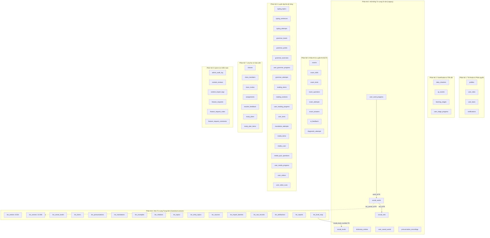

# LanguaLab Database Inventory & Architecture Map

> **Tài liệu kiểm toán kiến trúc cơ sở dữ liệu Supabase PostgreSQL**  
> **Dự án:** LanguaLab (Nền tảng học ngoại ngữ & Luyện thi thông minh)  
> **Thời điểm lập:** Tháng 11/2026  
> **Người thực hiện:** Senior PostgreSQL / Supabase Database Architect  
> **Trạng thái:** Hoàn thành kiểm toán toàn diện (71 Tables, 8 Views, 21 Migrations)

---

## 1. Tóm tắt điều hành (Executive Summary)

Cơ sở dữ liệu của LanguaLab được xây dựng trên nền tảng **PostgreSQL 15+ (Supabase)**, kết hợp chặt chẽ giữa **Row Level Security (RLS)**, các hàm bảo mật **SECURITY DEFINER** cố định `search_path`, thuật toán ghi nhớ lặp lại ngắt quãng **SM-2 (Spaced Repetition System)**, và kho từ vựng trung tâm mở quy mô lớn (**Lexicon Core** kế thừa Wiktionary, CEFR-J và Octanove).

Qua kiểm toán toàn bộ 21 bản migration (`20261022000001` đến `20261102000021`), hệ thống cơ sở dữ liệu bao gồm:
- **71 Bảng dữ liệu vật lý (Physical Tables)** chia thành 8 phân hệ chức năng.
- **8 Khung nhìn (Database Views)** phục vụ thống kê, bảng xếp hạng và tính toán tiến trình.
- **32 Hàm RPC / Helper Functions** có kiểm soát quyền thực thi.
- **2 Hệ thống từ vựng song song**:
  - **Hệ thống di sản (Legacy Vocabulary):** `vocab_levels`, `vocab_sets`, `vocab_words`, `user_word_progress`, `dictionary_entries`.
  - **Kho từ vựng trung tâm chuẩn hóa (Canonical Lexicon System):** Bộ bảng `lex_*` (16 bảng) chứa 8.554 mục từ và 31.948 nghĩa phân cấp CEFR A1–C2.

---

## 2. Bản đồ phân hệ cơ sở dữ liệu (Domain Architecture Map)

---

## 3. Chi tiết kiểm toán 8 Phân hệ Cơ sở dữ liệu

### Phân hệ 1: Tài khoản, Hồ sơ & Kiểm soát truy cập (Identity & Access)

| Tên bảng | Mục đích nghiệp vụ | Số lượng bản ghi ước tính | Khóa chính / Khóa ngoại | Triggers | RLS Policy tóm tắt |
|---|---|---|---|---|---|
| `profiles` | Hồ sơ người dùng công khai: tên, avatar, streak, hearts, cấp độ mục tiêu | 1 dòng / người dùng đăng ký | PK: `id` (references `auth.users`) | `tr_profiles_updated_at` | Mọi người đọc; người dùng chỉ sửa hồ sơ của chính mình |
| `user_roles` | Bảng phân quyền Role-based: `student`, `teacher`, `admin` | 1 dòng / người dùng | PK: `(user_id, role)` FK: `user_id -> auth.users` | Không | Người dùng đọc quyền của mình; chỉ admin được sửa |
| `user_bans` | Nhật ký khóa tài khoản vi phạm, lưu lý do và thời hạn | Bản ghi phát sinh khi phạt | PK: `user_id` FK: `banned_by -> profiles` | Không | Chỉ quản trị viên (`is_admin()`) đọc và ghi |
| `notifications` | Thông báo trong ứng dụng cho học viên | Động theo hoạt động | PK: `id` (UUID) FK: `user_id -> profiles` | Không | Chỉ chủ sở hữu đọc/sửa trạng thái `is_read` |

---

### Phân hệ 2: Gamification, Chuỗi học & Lộ trình (Gamification & Retention)

| Tên bảng / View | Mục đích nghiệp vụ | Số lượng bản ghi | Khóa chính / Khóa ngoại | Triggers | RLS Policy / Chú thích |
|---|---|---|---|---|---|
| `daily_checkins` | Điểm danh giữ chuỗi streak hàng ngày | 1 dòng / ngày / user | PK: `id` FK: `user_id -> profiles` UQ: `(user_id, checkin_date)` | Không | Người dùng xem và tạo chuỗi của mình qua RPC |
| `xp_events` | Sổ cái giao dịch XP chống gian lận (Anti-cheat Ledger) | Bản ghi phát sinh khi học | PK: `id` FK: `user_id -> profiles` | Không | Client bị chặn ghi trực tiếp; chỉ ghi qua RPC `award_xp()` |
| `learning_stages` | Các chặng học trên bản đồ lộ trình (Duolingo-style milestones) | ~20 - 50 chặng hệ thống | PK: `id` (TEXT, e.g. `stage-1`) | `tr_learning_stages_updated_at` | Đọc công khai; chỉ Admin quản lý |
| `user_stage_progress` | Tiến độ mở khóa chặng và sao đạt được của học viên | Động theo user | PK: `id` FK: `user_id`, `stage_id` | `tr_user_stage_progress_updated_at` | Học viên quản lý tiến độ chặng của bản thân |
| *View:* `user_xp_totals` | Tổng hợp XP tích lũy toàn thời gian của người dùng | View động | N/A (Truy vấn từ `xp_events`) | N/A | Dùng cho Profile và Header |
| *View:* `weekly_leaderboard` | Bảng xếp hạng thi đua học tập trong tuần hiện tại | View động | N/A (Truy vấn từ `xp_events` trong tuần) | N/A | Dùng cho trang Bảng xếp hạng |
| *View:* `daily_user_stats` | Thống kê số phút học và câu trả lời trong ngày | View động | N/A | N/A | Dashboard tiến độ |
| *View:* `weekly_user_summary` | Thống kê hoàn thành kỹ năng trong 7 ngày | View động | N/A | N/A | Dashboard tiến độ |

---

### Phân hệ 3: Hệ thống Từ vựng Di sản (Legacy Vocabulary System)

> [!WARNING]
> Đây là phân hệ được thiết kế ở các giai đoạn đầu (Migration 4 & 8). Phân hệ này đang chạy song song với kho Lexicon mới.

| Tên bảng / View | Mục đích nghiệp vụ | Số bản ghi hiện tại | Khóa chính / Khóa ngoại | Phụ thuộc chính | RLS Policy |
|---|---|---|---|---|---|
| `vocab_levels` | 7 thang độ khó từ vựng (1 đến 7) | **7 dòng** (Cố định) | PK: `id` (SERIAL), UQ: `level_number`, `code` | Được `lex_level_map` và `vocab_sets` tham chiếu | Đọc công khai (`true`), Admin quản lý |
| `vocab_sets` | Bộ sưu tập từ vựng (Bộ hệ thống hoặc Bộ người dùng tự tạo) | ~10 - 20 bộ | PK: `id` (UUID) FK: `user_id -> profiles`, `level_id -> vocab_levels` | `vocab_words.set_id` tham chiếu | Đọc: Bộ hệ thống (`is_system = true`) hoặc bộ của chính user; Ghi: User quản lý bộ của mình |
| `vocab_words` | Từ vựng phẳng trong từng bộ từ (thuộc tính: `word`, `meaning_vi`, `example_sentence`) | ~100 - 500 từ | PK: `id` (UUID) FK: `set_id -> vocab_sets`, `lex_sense_id -> lex_senses` (M18) | `user_word_progress.word_id` tham chiếu | Kế thừa theo quyền sở hữu của `vocab_sets` |
| `user_word_progress` | Tiến trình ghi nhớ lặp lại ngắt quãng SM-2 của từng từ | Động theo số từ học | PK: `id` (UUID) FK: `user_id -> profiles`, `word_id -> vocab_words` UQ: `(user_id, word_id)` | `words_due_today` và `user_vocab_levels_summary` tham chiếu | Học viên xem tiến trình của mình; Cập nhật qua RPC `review_word()` |
| `dictionary_entries` | Mục từ điển cũ lưu dạng JSONB | **2 dòng** (`pragmatic`, `ubiquitous`) | PK: `id` (UUID) UQ: `(language, headword)` | `SupabaseDictionaryProvider` (fallback), `useGlobalSearch` | Đọc công khai; Admin quản lý |
| `user_saved_words` | Bảng phụ lưu từ nhanh khi xem video hoặc đọc bài | Động theo tương tác user | PK: `id` (UUID) FK: `user_id -> profiles` UQ: `(user_id, word)` | Phục vụ bookmark nhanh | Học viên quản lý từ đã lưu của mình |
| `pronunciation_recordings`| File ghi âm phát âm của người học lưu trữ trên Storage | Động | PK: `id` FK: `user_id -> profiles` | Lưu file `pronunciation-recordings` | Học viên quản lý bản ghi âm của mình |
| *View:* `words_due_today` | Danh sách từ đến hạn ôn tập SM-2 hôm nay | View động | N/A (JOIN `user_word_progress` + `vocab_words` + `vocab_sets`) | N/A | Dùng cho widget Dashboard trang chủ |
| *View:* `user_vocab_levels_summary` | Thống kê số từ đã học theo 7 cấp độ | View động | N/A (JOIN `vocab_levels` + `vocab_sets` + `vocab_words` + `user_word_progress`) | N/A | Dùng cho thanh tiến độ trang chủ |

---

### Phân hệ 4: Kho Từ vựng Trung tâm Chuẩn hóa (Canonical Lexicon System)

> [!IMPORTANT]
> Đây là nguồn dữ liệu từ điển và học tập chuẩn hóa của LanguaLab từ Migration 18 trở đi. Không được xóa hoặc sửa cấu trúc ngoài các migration mới.

| Tên bảng / View | Mục đích nghiệp vụ | Số lượng bản ghi | Khóa chính / Khóa ngoại | Triggers / Ràng buộc | RLS Policy |
|---|---|---|---|---|---|
| `lex_sources` | Quản trị nguồn cấp dữ liệu & giấy phép bản quyền (Wiktionary, CEFR-J, Octanove...) | 3 nguồn chính | PK: `id` (UUID), UQ: `code` | Bắt buộc đối chiếu `license_verified` | Đọc công khai; Admin quản lý |
| `lex_import_batches`| Lịch sử các đợt nạp dữ liệu hàng loạt từ pipeline | 1+ batches | PK: `id` FK: `source_id -> lex_sources` | Trạng thái: `pending`, `processing`, `completed`, `failed` | Chỉ Admin quản lý |
| `lex_raw_records` | Bản ghi gốc JSONB phục vụ truy vết và đối soát nguồn | ~8.554 bản ghi gốc | PK: `id` FK: `batch_id -> lex_import_batches` | UQ: `(batch_id, external_id)` | Chỉ Admin quản lý |
| `lex_entries` | **Mục từ gốc (Canonical Lemma)** | **8.554 dòng** | PK: `id` (UUID) UQ: `(language, entry_type, normalized_lemma)` | `tr_lex_entries_guard_publish` (chặn publish nếu thiếu nghĩa approved) | Đọc: `status = 'published'`; Admin có toàn quyền |
| `lex_senses` | **Định nghĩa chi tiết theo ngữ cảnh** | **31.948 dòng** | PK: `id` (UUID) FK: `entry_id -> lex_entries` UQ: `(entry_id, sense_order)` | `chk_lex_sense_level` (kiểm tra A1..C2, HSK, JLPT) | Đọc: `review_status = 'approved'` & entry đã published; Admin toàn quyền |
| `lex_sense_levels` | Cấp độ theo từng nguồn đánh giá độc lập (CEFR-J, Octanove) | 9.011 dòng | PK: `id` FK: `sense_id -> lex_senses`, `source_id -> lex_sources` | UQ: `(sense_id, source_id, level_system)` | Kế thừa theo quyền công khai của `lex_senses` |
| `lex_forms` | Các dạng biến thể của từ (số nhiều, quá khứ, phân từ...) | 22.000+ dòng | PK: `id` FK: `entry_id -> lex_entries` UQ: `(entry_id, form, form_type)` | Index `idx_lex_forms_lower` tra cứu dạng từ | Kế thừa theo quyền công khai của `lex_entries` |
| `lex_pronunciations`| Phiên âm IPA, giọng đọc và audio | 8.500+ dòng | PK: `id` FK: `entry_id -> lex_entries` UQ: `(entry_id, kind, accent)` | Chặn bản ghi trống cả IPA và audio | Kế thừa theo quyền công khai của `lex_entries` |
| `lex_translations` | Bản dịch tiếng Việt của từng nghĩa | 15.000+ dòng | PK: `id` FK: `sense_id -> lex_senses` UQ: `(sense_id, language_code, translated_text)` | Trạng thái duyệt: `pending`, `approved`, `rejected` | Đọc: `review_status = 'approved'`; Admin toàn quyền |
| `lex_examples` | Câu ví dụ song ngữ minh họa | 18.000+ dòng | PK: `id` FK: `sense_id -> lex_senses`, `source_id -> lex_sources` | Trạng thái duyệt: `pending`, `approved`, `rejected` | Đọc: `review_status = 'approved'`; Admin toàn quyền |
| `lex_relations` | Mối quan hệ từ vựng (Từ đồng nghĩa, trái nghĩa, collocation) | 5.000+ dòng | PK: `id` FK: `source_entry_id -> lex_entries`, `target_entry_id` | Ràng buộc không tự tham chiếu chính mình | Đọc công khai nếu cả 2 đầu mục từ đã published |
| `lex_topics` | Danh mục chủ đề và thẻ kỳ thi (IELTS, TOEIC, Daily Life) | 50+ chủ đề | PK: `id` UQ: `slug`, UQ: `(kind, name)` | Phân loại: `topic` hoặc `exam_tag` | Đọc công khai; Admin quản lý |
| `lex_entry_topics` | Bảng liên kết nhiều - nhiều giữa mục từ và chủ đề | Động | PK: `(entry_id, topic_id)` FK: `lex_entries`, `lex_topics` | Index trên `topic_id` | Kế thừa theo quyền công khai của `lex_entries` |
| `lex_attributions` | Bảng truy vết giấy phép và link nguồn cho từng thực thể | 8.554+ dòng | PK: `id` FK: `source_id -> lex_sources`, `raw_record_id` | Index `(entity_type, entity_id)` | Chỉ Admin đọc ghi |
| `lex_reports` | Báo cáo sai sót từ người dùng (lỗi nghĩa, dịch, phát âm) | Phát sinh khi dùng | PK: `id` FK: `user_id -> profiles`, `entry_id -> lex_entries` | Trạng thái: `open`, `resolved`, `dismissed` | Người dùng tạo và xem báo cáo của chính mình |
| `lex_level_map` | Ánh xạ cấp độ CEFR/HSK/JLPT về thang độ khó 1-7 | 22 dòng | PK: `(level_system, level)` FK: `vocab_level_number -> vocab_levels` | Toàn vẹn dữ liệu quy đổi thang điểm | Đọc công khai; Admin quản lý |
| *View:* `lex_coverage_stats` | Thống kê tỷ lệ phủ phiên âm, nghĩa và dịch tiếng Việt | View động | N/A (Truy vấn tổng hợp `lex_*`) | N/A | Dùng cho báo cáo kiểm toán dữ liệu |

---

### Phân hệ 5: Khảo thí & Luyện thi IELTS (Exams & Assessment)

| Tên bảng | Mục đích nghiệp vụ | Số lượng bản ghi | Khóa chính / Khóa ngoại | Triggers | RLS Policy |
|---|---|---|---|---|---|
| `exams` | Danh mục kỳ thi (IELTS, TOEIC, TOEFL, HSK, JLPT) | 5 dòng | PK: `id` (TEXT) | Không | Đọc công khai; Admin quản lý |
| `exam_skills` | Kỹ năng thi (Listening, Reading, Writing, Speaking) | 4 dòng / kỳ thi | PK: `id` (TEXT) FK: `exam_id -> exams` | Không | Đọc công khai; Admin quản lý |
| `exam_tests` | Đề thi hoàn chỉnh (Cambridge IELTS 16-19 Test 1-4) | 20+ đề thi | PK: `id` (UUID) FK: `exam_id`, `skill_id` | `tr_exam_tests_updated_at` | Đọc: `is_published = true` hoặc Admin |
| `exam_questions` | Câu hỏi chi tiết, bài đọc, file audio nghe và trích dẫn bằng chứng | 800+ câu hỏi | PK: `id` (UUID) FK: `test_id -> exam_tests` | Lưu `evidence_quote` và audio timestamps | Kế thừa theo trạng thái xuất bản của đề |
| `exam_attempts` | Lượt làm bài thi của học viên, điểm số, band score | Động theo thí sinh | PK: `id` (UUID) FK: `user_id -> profiles`, `test_id` | Chấm điểm tự động qua RPC `submit_exam_attempt` | Thí sinh xem kết quả của mình; Admin quản lý |
| `exam_answers` | Chi tiết câu trả lời của thí sinh cho từng câu hỏi | Động theo attempt | PK: `id` FK: `attempt_id -> exam_attempts`, `question_id` | Chống gian lận không để lộ đáp án trước khi nộp | Thí sinh xem bài làm của mình |
| `ai_feedback` | Nhận xét chi tiết và chấm điểm Band IELTS từ AI (Gemini) | Động theo bài Writing/Speaking | PK: `id` FK: `attempt_id -> exam_attempts` | Phân tích 4 tiêu chí: TR, CC, LR, GRA | Thí sinh xem feedback của bài làm mình |
| `diagnostic_attempts`| Lượt làm bài kiểm tra đầu vào xác định trình độ | Động | PK: `id` FK: `user_id -> profiles` | Đề xuất lộ trình học phù hợp | Học viên xem kết quả của bản thân |

---

### Phân hệ 6: Luyện tập Đa kỹ năng (Skills Practice: Typing, Grammar, Reading, Media)

| Nhóm kỹ năng | Các bảng dữ liệu | Mục đích | RLS & Kiểm soát quyền |
|---|---|---|---|
| **Gõ câu (Typing)** | `typing_topics`, `typing_sentences`, `typing_attempts` | Luyện gõ phím phản xạ theo ngữ cảnh giao tiếp và công sở (WPM, độ chính xác) | Nội dung công khai nếu `is_published = true`; Lượt gõ do học viên sở hữu |
| **Ngữ pháp (Grammar)** | `grammar_levels`, `grammar_points`, `grammar_exercises`, `user_grammar_progress`, `grammar_attempts` | Bài học ngữ pháp có cấu trúc, ví dụ song ngữ và bài tập trắc nghiệm / điền từ | Nội dung học do Admin duyệt; Tiến trình thuộc quyền riêng tư của học viên |
| **Kho Đọc & Dịch** | `reading_items`, `reading_sections`, `user_reading_progress`, `user_texts`, `translation_attempts` | Đọc báo, truyện ngắn song ngữ, tra cứu từ vựng theo đoạn văn và tự tải bài đọc | Nội dung hệ thống được kiểm duyệt bản quyền; Bài viết cá nhân hoàn toàn riêng tư |
| **Video & Podcast** | `media_items`, `media_cues`, `media_quiz_questions`, `user_media_progress`, `user_videos`, `user_video_cues` | Xem video / nghe podcast có phụ đề song ngữ nhấp từ tra nghĩa; Không lưu file video (chỉ lưu YouTube URL) | Giới hạn tối đa 1.000 dòng phụ đề cá nhân qua trigger `check_user_video_cues_limit` |

---

### Phân hệ 7: Quản trị Lớp học & Giáo viên (Virtual Classrooms & Teachers)

| Tên bảng | Mục đích nghiệp vụ | Khóa chính / Khóa ngoại | Triggers | RLS Policy |
|---|---|---|---|---|
| `classes` | Lớp học ảo do giáo viên tạo | PK: `id` FK: `teacher_id -> profiles` | `tr_classes_updated_at` | Giáo viên quản lý lớp của mình; Học viên xem lớp mình tham gia |
| `class_members` | Danh sách học viên trong lớp | PK: `(class_id, student_id)` FK: `classes`, `profiles` | Không | Giáo viên và thành viên lớp có quyền xem |
| `class_invites` | Mã mời tham gia lớp học có hạn sử dụng | PK: `id` (UUID), UQ: `invite_code` FK: `class_id -> classes` | Không | Giáo viên tạo mã; Người dùng xác thực mã qua RPC `join_class` |
| `assignments` | Bài tập về nhà do giáo viên giao | PK: `id` FK: `class_id -> classes` | `tr_assignments_updated_at` | Giáo viên giao bài; Học viên trong lớp nộp bài |
| `teacher_feedback`| Nhận xét và điểm số của giáo viên cho bài nộp | PK: `id` FK: `assignment_id -> assignments`, `student_id` | Không | Giáo viên chấm bài; Học viên xem phản hồi của mình |
| `study_plans` | Kế hoạch học tập cá nhân hóa 7, 14 hoặc 30 ngày | PK: `id` FK: `user_id -> profiles` | Không | Học viên quản lý kế hoạch học của mình |
| `study_plan_items`| Từng mục tiêu nhiệm vụ hàng ngày trong kế hoạch | PK: `id` FK: `plan_id -> study_plans` | Không | Học viên đánh dấu hoàn thành nhiệm vụ |

---

### Phân hệ 8: Quản trị Nền tảng, Kiểm duyệt & Cộng đồng (Governance & Admin)

| Tên bảng / View | Mục đích nghiệp vụ | Khóa chính / Khóa ngoại | Triggers | RLS Policy |
|---|---|---|---|---|
| `admin_audit_log` | Nhật ký bất biến ghi lại mọi thao tác quản trị nhạy cảm | PK: `id` (BIGSERIAL) FK: `actor_id -> profiles` | Không | Chỉ quản trị viên đọc qua RPC `admin_list_audit` |
| `content_reviews` | Lịch sử các bước kiểm duyệt nội dung (nháp -> chờ duyệt -> xuất bản) | PK: `id` FK: `actor_id -> profiles` | Không | Quản trị viên xem lịch sử kiểm duyệt |
| `content_import_logs`| Nhật ký lưu kết quả các lần import CSV/JSON qua Import Wizard | PK: `id` FK: `imported_by -> profiles` | Không | Chỉ Admin có quyền xem và ghi |
| `feature_requests` | Diễn đàn đề xuất tính năng mới do cộng đồng gửi | PK: `id` FK: `user_id -> profiles` | Không | Mọi người đọc; Thành viên đăng đề xuất |
| `feature_request_votes`| Phiếu bình chọn cho tính năng | PK: `(request_id, user_id)` | `tr_feature_request_vote_count` (tự tăng giảm vote_count) | Mỗi người dùng vote 1 lần / tính năng |
| `feature_request_comments`| Bình luận thảo luận tính năng | PK: `id` FK: `request_id`, `user_id` | Không | Đọc công khai; Tác giả quản lý bình luận |
| *View:* `feature_requests_public`| Danh sách tính năng công khai kèm tổng vote và tác giả | View động | N/A | Dùng cho trang /yeu-cau-tinh-nang |

---

## 4. Bảng tổng hợp số lượng và trạng thái các bảng

| Trạng thái kiến trúc | Số lượng bảng | Danh sách bảng |
|---|:---:|---|
| **Hoạt động cốt lõi (Active Core)** | **64 bảng** | Tất cả các bảng thuộc Phân hệ 1, 2, 4, 5, 6, 7, 8 |
| **Hệ thống Từ vựng Di sản (Active Legacy)** | **4 bảng** | `vocab_levels`, `vocab_sets`, `vocab_words`, `user_word_progress` |
| **Ứng viên Deprecate / Xóa an toàn (Obsolete Candidate)** | **1 bảng** | `dictionary_entries` (chỉ chứa 2 dòng thử nghiệm, đã có kho Lexicon thay thế 100%) |
| **Bảng phụ trợ lưu trữ cá nhân (Auxiliary)** | **2 bảng** | `user_saved_words`, `pronunciation_recordings` |
| **Tổng cộng** | **71 bảng** | *(Kèm 8 Views động)* |
