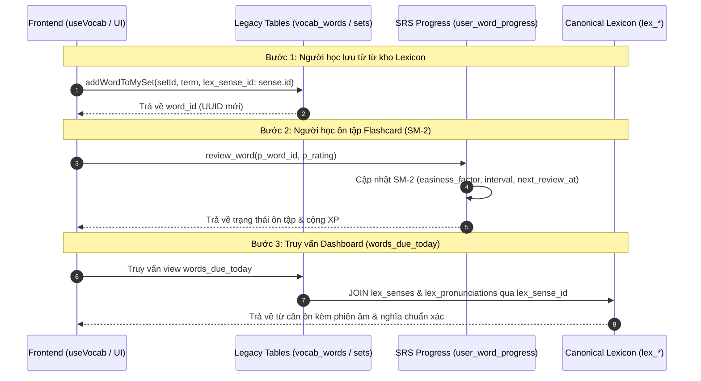

# LanguaLab Legacy Vocabulary Migration & Modernization Strategy

> **Tài liệu thiết kế quy trình di chuyển dữ liệu từ vựng sang kho Canonical Lexicon**  
> **Dự án:** LanguaLab (Giai đoạn 2: Hợp nhất Cơ sở Dữ liệu & Từ vựng)  
> **Kiến trúc sư:** Senior Supabase / PostgreSQL Database Architect  
> **Trạng thái:** Kế hoạch kỹ thuật chi tiết (Zero-Downtime, Zero-Data-Loss)

---

## 1. Mục tiêu chiến lược & Nguyên tắc thiết kế

1. **Đưa `lex_*` thành nguồn chân lý duy nhất (Single Source of Truth):** Toàn bộ dữ liệu tra cứu, phân cấp CEFR, phiên âm IPA, âm thanh, bản dịch tiếng Việt và ví dụ đều phải bắt nguồn từ `lex_entries`, `lex_senses`, `lex_translations`, `lex_examples`.
2. **Bảo tồn nguyên vẹn 100% tiến trình học tập của người dùng:** Dữ liệu trong `user_word_progress` (hệ số dễ `easiness_factor`, số lần lặp `repetition_count`, ngày ôn tới `next_review_at`) và chuỗi XP không được phép suy suyển.
3. **Cầu nối dữ liệu không ngắt quãng (Non-breaking Bridge):** Tận dụng cột khóa ngoại `vocab_words.lex_sense_id` (đã sinh ra ở Migration 18) để liên kết các từ vựng hiện có sang `lex_senses.id`.
4. **Bảo tồn chức năng `user_saved_words` và `pronunciation_recordings`:** Người học vẫn lưu từ khi xem video, đọc báo và ghi âm giọng đọc bình thường.
5. **Giữ nguyên `vocab_levels`:** Do `lex_level_map` đang có khóa ngoại `RESTRICT` trỏ vào `vocab_levels.level_number`, ta giữ nguyên `vocab_levels` làm bảng danh mục chuẩn độ khó (thang 1-7).
6. **Loại bỏ `dictionary_entries` an toàn:** Gỡ bỏ các nhánh fallback trong frontend trước khi tiến hành xóa bảng.

---

## 2. Kế hoạch di chuyển từng thành phần (Component Migration Plan)



---

### 2.1 Di chuyển Bộ từ vựng (`vocab_sets`) & Thẻ từ (`vocab_words`)

- **Bản chất nghiệp vụ:** `vocab_sets` là danh sách bài học / bộ sưu tập thẻ từ của người dùng (tương tự Playlist trong Spotify hoặc Deck trong Anki). Không nên xóa khái niệm này, mà nâng cấp nó thành tập hợp các tham chiếu ngữ nghĩa.
- **Giải pháp chuyển đổi:**
  1. Giữ nguyên cấu trúc bảng `vocab_sets`.
  2. Bổ sung dữ liệu (Backfill) cho cột `vocab_words.lex_sense_id`:
     - Chạy script đối chiếu tự động: Với mỗi dòng trong `vocab_words`, tìm kiếm `lex_entries` có `normalized_lemma = LOWER(TRIM(vocab_words.word))`.
     - Lấy `lex_senses.id` của nghĩa đầu tiên (`sense_order = 1`) gán vào `vocab_words.lex_sense_id`.
  3. Cập nhật hàm frontend `saveLexWordToMySet` trong `frontend/app/composables/useVocab.ts`:
     - Khi lưu từ từ kho Lexicon vào bộ từ cá nhân, truyền trực tiếp `lex_sense_id: item.id`.
     - Cột `word`, `phonetic`, `meaning_vi` trong `vocab_words` đóng vai trò là bản snapshot nhanh (denormalized cache), trong khi `lex_sense_id` là liên kết chính tới kho dữ liệu trung tâm.

---

### 2.2 Bảo tồn Tiến trình học tập SRS (`user_word_progress`)

- **Ràng buộc:** `user_word_progress.word_id` trỏ vào `vocab_words.id`.
- **Giải pháp:**
  - Giữ nguyên quan hệ `user_word_progress -> vocab_words`. Bằng cách backfill `vocab_words.lex_sense_id`, ta gián tiếp liên kết toàn bộ tiến trình học tập của người dùng tới `lex_senses` mà **không cần thay đổi kiểu dữ liệu hoặc cấu trúc khóa chính của `user_word_progress`**.
  - Hàm RPC `review_word(p_word_id UUID, p_rating INTEGER)` tiếp tục hoạt động 100% bình thường, không gây ra bất kỳ breaking change nào cho phiên bản ứng dụng hiện tại.

---

### 2.3 Bảo tồn chức năng Từ đã lưu (`user_saved_words`) & Ghi âm (`pronunciation_recordings`)

1. **`user_saved_words`:**
   - Bảng này dùng để lưu từ nhanh khi người học gặp từ mới trong video YouTube hoặc bài đọc báo chí.
   - Bổ sung thêm 2 cột tùy chọn:
     ```sql
     ALTER TABLE public.user_saved_words
       ADD COLUMN IF NOT EXISTS lex_entry_id UUID REFERENCES public.lex_entries(id) ON DELETE SET NULL,
       ADD COLUMN IF NOT EXISTS lex_sense_id UUID REFERENCES public.lex_senses(id) ON DELETE SET NULL;
     ```
   - Khi người học tra từ qua popup từ điển và bấm "Lưu từ", hệ thống lưu kèm `lex_entry_id` và `lex_sense_id`. Nếu từ không có trong kho, các cột này mang giá trị `NULL` và vẫn lưu văn bản thuần như cũ. Chức năng hoàn toàn được bảo tồn.
2. **`pronunciation_recordings`:**
   - Bảng này lưu file ghi âm phát âm (`audio_path` trên Supabase Storage) và điểm số AI chấm.
   - Khóa ngoại `word_id UUID REFERENCES public.vocab_words(id) ON DELETE SET NULL` đã có `ON DELETE SET NULL`.
   - Bổ sung thêm cột `lex_entry_id`:
     ```sql
     ALTER TABLE public.pronunciation_recordings
       ADD COLUMN IF NOT EXISTS lex_entry_id UUID REFERENCES public.lex_entries(id) ON DELETE SET NULL;
     ```
   - Đảm bảo bản ghi âm vẫn tồn tại độc lập ngay cả khi thẻ từ trong bộ từ bị xóa.

---

### 2.4 Thay thế Khung nhìn Di sản (`words_due_today` & `user_vocab_levels_summary`)

Các view hiện tại đang JOIN thuần văn bản thô từ `vocab_words`. Ta thiết kế lại các view này để ưu tiên lấy dữ liệu chuẩn hóa từ `lex_senses` khi có `lex_sense_id`:

#### Khung nhìn nâng cấp `words_due_today`:
```sql
CREATE OR REPLACE VIEW public.words_due_today AS
SELECT
  p.id AS progress_id,
  p.user_id,
  p.next_review_at,
  p.repetition_count,
  p.easiness_factor,
  p.interval_days,
  w.id AS word_id,
  -- Ưu tiên lấy lemma chuẩn từ kho Lexicon nếu có liên kết
  COALESCE(le.lemma, w.word) AS word,
  -- Ưu tiên lấy phiên âm IPA chính thức từ kho Lexicon
  COALESCE(lp.transcription, w.phonetic) AS phonetic,
  COALESCE(ls.part_of_speech, w.part_of_speech) AS part_of_speech,
  -- Ưu tiên lấy bản dịch tiếng Việt đã duyệt từ lex_translations
  COALESCE(lt.translated_text, w.meaning_vi) AS meaning_vi,
  -- Ưu tiên câu ví dụ chuẩn từ lex_examples
  COALESCE(lx.sentence, w.example_sentence) AS example_sentence,
  COALESCE(lx.sentence_vi, w.example_translation) AS example_translation,
  COALESCE(lp.audio_url, w.audio_url) AS audio_url,
  s.title AS set_title,
  CASE WHEN p.interval_days <= 1 OR p.incorrect_count > p.correct_count THEN true ELSE false END AS is_critical
FROM public.user_word_progress p
JOIN public.vocab_words w ON p.word_id = w.id
JOIN public.vocab_sets s ON w.set_id = s.id
LEFT JOIN public.lex_senses ls ON w.lex_sense_id = ls.id
LEFT JOIN public.lex_entries le ON ls.entry_id = le.id
LEFT JOIN public.lex_pronunciations lp ON lp.entry_id = le.id
LEFT JOIN public.lex_translations lt ON lt.sense_id = ls.id AND lt.review_status = 'approved'
LEFT JOIN public.lex_examples lx ON lx.sense_id = ls.id AND lx.review_status = 'approved'
WHERE p.next_review_at <= NOW();
```

---

### 2.5 Loại bỏ hoàn toàn Bảng `dictionary_entries`

#### Bước 1: Cắt đứt mã nguồn Frontend khỏi bảng cũ
1. Sửa `frontend/app/composables/dictionary/provider.ts`:
   - Xóa bỏ các khối truy vấn `this.client.from('dictionary_entries')`.
   - Nếu từ điển `lex_*` không có kết quả, trả về `null` ngay lập tức.
2. Sửa `frontend/app/composables/useGlobalSearch.ts`:
   - Chuyển đổi khối tìm kiếm số 5 (Dictionary entries) sang gọi RPC `search_lex_entries`.
3. Sửa `frontend/app/pages/admin/index.vue`:
   - Gỡ bỏ hoàn toàn `client.from('dictionary_entries').select('*', { count: 'exact', head: true })`.

#### Bước 2: Thực thi Script sao lưu và Migration dọn dẹp
- Sau khi kiểm tra log không còn query nào gửi tới `dictionary_entries`, thực thi lệnh gỡ bỏ bảng này khỏi database.

---

## 3. Kịch bản SQL Di chuyển Dữ liệu (Idempotent Data Migration Script)

> [!NOTE]
> Script dưới đây được thiết kế chạy an toàn trong một Transaction duy nhất (`BEGIN ... COMMIT`). Nếu có bất kỳ lỗi nào phát sinh, toàn bộ thao tác sẽ tự động được hoàn tác (Rollback).

```sql
-- migration_phase2_bridge_lexicon.sql
-- Áp dụng cầu nối kho Lexicon và chuẩn hóa dữ liệu di sản

BEGIN;

-- 1. Bổ sung các cột cầu nối cho user_saved_words và pronunciation_recordings
ALTER TABLE public.user_saved_words
  ADD COLUMN IF NOT EXISTS lex_entry_id UUID REFERENCES public.lex_entries(id) ON DELETE SET NULL,
  ADD COLUMN IF NOT EXISTS lex_sense_id UUID REFERENCES public.lex_senses(id) ON DELETE SET NULL;

CREATE INDEX IF NOT EXISTS idx_user_saved_words_lex_sense 
  ON public.user_saved_words(lex_sense_id);

ALTER TABLE public.pronunciation_recordings
  ADD COLUMN IF NOT EXISTS lex_entry_id UUID REFERENCES public.lex_entries(id) ON DELETE SET NULL;

CREATE INDEX IF NOT EXISTS idx_pronunciation_recordings_lex_entry 
  ON public.pronunciation_recordings(lex_entry_id);

-- 2. Backfill: Tự động liên kết các từ trong vocab_words với lex_senses.id
-- Chỉ gán cho các bản ghi đang có lex_sense_id IS NULL
WITH matched_senses AS (
  SELECT DISTINCT ON (vw.id)
    vw.id AS vocab_word_id,
    ls.id AS matched_sense_id
  FROM public.vocab_words vw
  JOIN public.lex_entries le 
    ON lower(btrim(vw.word)) = le.normalized_lemma
  JOIN public.lex_senses ls 
    ON ls.entry_id = le.id
  WHERE vw.lex_sense_id IS NULL
  ORDER BY vw.id, ls.sense_order ASC
)
UPDATE public.vocab_words vw
SET lex_sense_id = ms.matched_sense_id
FROM matched_senses ms
WHERE vw.id = ms.vocab_word_id;

-- 3. Cập nhật các View để đọc dữ liệu ưu tiên từ Lexicon
-- (Áp dụng định nghĩa view words_due_today đã nêu ở mục 2.4)

COMMIT;
```

---

## 4. Hướng dẫn Hoàn tác (Rollback Instructions)

Nếu cần hoàn tác các thay đổi trên mà không làm mất dữ liệu người dùng:

```sql
BEGIN;

-- 1. Hoàn tác View words_due_today về bản Migration 4 ban đầu
CREATE OR REPLACE VIEW public.words_due_today AS
SELECT
  p.id AS progress_id,
  p.user_id,
  p.next_review_at,
  p.repetition_count,
  p.easiness_factor,
  p.interval_days,
  w.id AS word_id,
  w.word,
  w.phonetic,
  w.part_of_speech,
  w.meaning_vi,
  w.example_sentence,
  w.example_translation,
  w.audio_url,
  s.title AS set_title,
  CASE WHEN p.interval_days <= 1 OR p.incorrect_count > p.correct_count THEN true ELSE false END AS is_critical
FROM public.user_word_progress p
JOIN public.vocab_words w ON p.word_id = w.id
JOIN public.vocab_sets s ON w.set_id = s.id
WHERE p.next_review_at <= NOW();

-- 2. Gỡ bỏ các chỉ mục mới
DROP INDEX IF EXISTS public.idx_user_saved_words_lex_sense;
DROP INDEX IF EXISTS public.idx_pronunciation_recordings_lex_entry;

-- 3. Gỡ bỏ các cột phụ đã thêm (Dữ liệu chính trong bảng vẫn nguyên vẹn)
ALTER TABLE public.user_saved_words
  DROP COLUMN IF EXISTS lex_entry_id,
  DROP COLUMN IF EXISTS lex_sense_id;

ALTER TABLE public.pronunciation_recordings
  DROP COLUMN IF EXISTS lex_entry_id;

-- 4. Đặt lại lex_sense_id của vocab_words về NULL nếu cần
-- UPDATE public.vocab_words SET lex_sense_id = NULL;

COMMIT;
```

---

## 5. Kịch bản Kiểm tra Xác thực Dữ liệu (Validation Queries)

Chạy các câu lệnh sau để đối chiếu trước và sau khi chạy di chuyển dữ liệu:

```sql
-- V1. Kiểm tra số lượng từ vocab_words đã được liên kết thành công
SELECT 
    count(*) AS total_vocab_words,
    count(lex_sense_id) AS linked_count,
    round(count(lex_sense_id)::numeric / count(*) * 100, 2) AS percent_linked
FROM public.vocab_words;

-- V2. Kiểm tra tiến trình học SM-2 vẫn khớp 100% với vocab_words
SELECT count(*) AS total_progress_records,
       count(vw.id) AS valid_word_references
FROM public.user_word_progress p
JOIN public.vocab_words vw ON p.word_id = vw.id;

-- V3. Kiểm tra view words_due_today hoạt động bình thường và không sinh ra bản ghi NULL
SELECT count(*) AS due_today_count,
       count(word) AS valid_words,
       count(meaning_vi) AS valid_meanings
FROM public.words_due_today;
```
