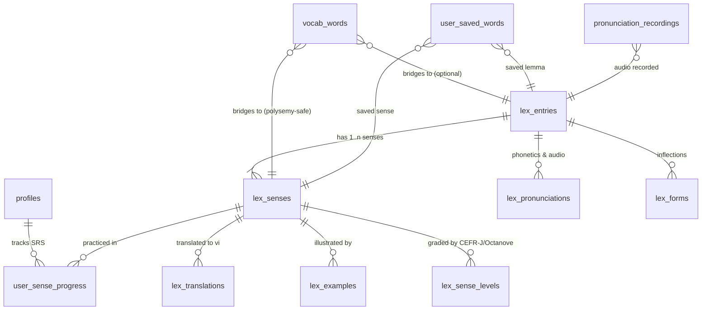

# LanguaLab – Thiết Kế Di Chuyển Sang Canonical Lexicon (Lexicon Migration Design)

## 1. Tổng Quan & Bối Cảnh
Hệ thống từ vựng của LanguaLab đang hoàn tất quá trình chuyển đổi từ cấu trúc danh mục bài học cũ (`vocab_levels`, `vocab_sets`, `vocab_words`, `dictionary_entries`) sang **Kho Từ Vựng Trung Tâm Chuẩn Hoá (Canonical Lexicon System - tiền tố `lex_*`)**.

### Mục Tiêu Cốt Lõi:
1. **Nguồn dữ liệu chân lý duy nhất (Single Source of Truth)**: Mọi tra cứu từ điển, gợi ý tìm kiếm, liên kết phát âm và bài học đều quy về `lex_entries` và `lex_senses`.
2. **Học tập & SRS theo từng Nghĩa (Sense-Level Learning)**: Trong thực tế ngôn ngữ học, người học không học chung chung một "từ" mà học "nghĩa cụ thể của từ" tương ứng với ngữ cảnh và cấp độ CEFR (ví dụ: *run* nghĩa "chạy bộ" là A1, nhưng *run a company* nghĩa "điều hành" là B2).
3. **Bảo tồn toàn vẹn dữ liệu & An toàn tuyệt đối (Strict Safety)**:
   - Không DROP table, không DELETE data cũ.
   - Không ghi đè các migration đã áp dụng (000001 - 000021).
   - Bảo toàn 100% lịch sử học tập, XP, Streak và cấu hình của người dùng.
   - Tránh hiện tượng gán ép nghĩa tùy tiện (Polysemy Safety).

---

## 2. Kiến Trúc Dữ Liệu Mục Tiêu



### 2.1. Thực thể Tiến trình Học: `user_sense_progress`
Tiến trình học lặp lại ngắt quãng (Spaced Repetition System - SRS) sử dụng thuật toán SuperMemo SM-2 được lưu trữ trực tiếp trên từng nghĩa `lex_senses`:

| Cột | Kiểu | Mô tả |
| :--- | :--- | :--- |
| `id` | `UUID` (PK) | Mã tiến trình |
| `user_id` | `UUID` (FK -> `profiles`) | Học viên sở hữu |
| `sense_id` | `UUID` (FK -> `lex_senses`) | Nghĩa từ vựng đang học |
| `easiness_factor` | `NUMERIC(4,2)` | Hệ số dễ nhớ SM-2 (mặc định 2.50, sàn 1.30) |
| `repetition_count` | `INTEGER` | Số lần ôn tập thành công liên tiếp |
| `interval_days` | `INTEGER` | Khoảng cách ngày đến lần ôn kế tiếp |
| `correct_count` | `INTEGER` | Tổng số lần nhớ tốt (rating >= 3) |
| `incorrect_count`| `INTEGER` | Tổng số lần quên / khó (rating < 3) |
| `last_reviewed_at`| `TIMESTAMPTZ`| Thời điểm ôn tập gần nhất |
| `next_review_at` | `TIMESTAMPTZ`| Hạn ôn tập tiếp theo (dùng cho SRS Queue) |

Ràng buộc duy nhất: `UNIQUE(user_id, sense_id)`.

---

## 3. Nguyên Tắc An Toàn Đa Nghĩa (Polysemy Safety)

### 3.1. Rủi ro nếu gán bừa
Trong tiếng Anh, một từ có thể có từ 2 đến hàng chục nghĩa khác nhau (ví dụ: *bank* là bờ sông hay ngân hàng; *book* là quyển sách hay đặt phòng). Nếu script chuyển đổi tự động lấy nghĩa đầu tiên (`LIMIT 1`) để map cho từ vựng trong bộ flashcard của người học, người dùng đang học từ "đặt vé máy bay" sẽ bị hệ thống báo ôn tập "quyển sách", làm sai lệch toàn bộ trải nghiệm sư phạm.

### 3.2. Thuật toán Backfill Hai Tầng Tuyệt Đối An Toàn
Trong migration `20261102000022_consolidate_lexicon_learning.sql`, `vocab_words.lex_sense_id` chỉ được gán tự động khi đáp ứng 1 trong 2 điều kiện bất biến sau:

1. **Trường hợp Đơn Nghĩa Tuyệt Đối (Single-Sense Entry)**:
   ```sql
   WITH single_sense_entries AS (
     SELECT entry_id, MIN(id) AS sense_id
     FROM public.lex_senses
     GROUP BY entry_id
     HAVING COUNT(*) = 1
   )
   UPDATE public.vocab_words vw
   SET lex_sense_id = sse.sense_id
   FROM single_sense_entries sse
   WHERE vw.lex_entry_id = sse.entry_id AND vw.lex_sense_id IS NULL;
   ```
2. **Trường hợp Đơn Nghĩa Theo Từ Loại (Unambiguous Part of Speech)**:
   Nếu từ vựng trong bài học có từ loại xác định (ví dụ `verb`), và trong `lex_senses` của mục từ đó chỉ có duy nhất 1 nghĩa thuộc từ loại `verb`:
   ```sql
   WITH unambiguous_pos_senses AS (
     SELECT ls.entry_id, ls.part_of_speech, MIN(ls.id) AS sense_id
     FROM public.lex_senses ls
     GROUP BY ls.entry_id, ls.part_of_speech
     HAVING COUNT(*) = 1
   )
   UPDATE public.vocab_words vw
   SET lex_sense_id = ups.sense_id
   FROM unambiguous_pos_senses ups
   WHERE vw.lex_entry_id = ups.entry_id
     AND vw.lex_sense_id IS NULL
     AND lower(btrim(vw.part_of_speech)) = lower(btrim(ups.part_of_speech));
   ```
3. **Trường hợp Đa Nghĩa Không Rõ Ràng**:
   `lex_sense_id` **bắt buộc để NULL**. Người học khi tương tác hoặc thêm từ vào flashcard từ từ điển sẽ chỉ định chính xác nghĩa cần lưu.

---

## 4. Thuật Toán SRS SM-2 & Các Hàm RPC

### 4.1. Hàm RPC Chuẩn Mới: `review_lex_sense(p_sense_id UUID, p_rating INTEGER)`
- Đánh giá từ 1 đến 4:
  - `1`: Again (quên hẳn, interval reset về 1, reps reset về 0)
  - `2`: Hard (khó, interval reset về 1, reps reset về 0)
  - `3`: Good (nhớ tốt, tăng reps, áp dụng interval * EF)
  - `4`: Easy (rất dễ, tăng reps, áp dụng interval * EF)
- Tự động cộng 5 XP qua hệ thống `award_xp('word_review', p_sense_id::text, v_user_id)`.
- Chạy với `SECURITY DEFINER SET search_path = public` để bảo vệ chống gian lận client.

### 4.2. Tương Thích Ngược: `review_word(p_word_id UUID, p_rating INTEGER)`
- Giữ nguyên logic cập nhật `user_word_progress` để các màn hình Flashcard bộ từ cũ chạy bình thường.
- **Đồng bộ tự động**: Nếu `vocab_words.lex_sense_id` tồn tại, hàm tự động ghi nhận kết quả ôn tập vào `user_sense_progress`.

---

## 5. Tái Tạo Views Thống Kê & Báo Cáo Không Mất Dữ Liệu

1. **`words_due_today`**:
   - Sử dụng `UNION ALL` giữa `user_word_progress` và `user_sense_progress`.
   - Lọc bỏ trùng lặp nếu một nghĩa đã được học thông qua một `vocab_word` đến hạn.
   - Giữ nguyên toàn bộ cấu trúc cột cũ (`word_id`, `word`, `phonetic`, `part_of_speech`, `meaning_vi`, `is_critical`...) đồng thời bổ sung `sense_id`.

2. **`user_vocab_levels_summary`**:
   - Sử dụng bảng ánh xạ `lex_level_map` để phân cấp nghĩa học được về đúng 7 thang độ khó (Level 1: A1 đến Level 6: C2, Level 7: Chuyên sâu).
   - Cộng dồn số từ đã học từ legacy và số nghĩa học từ lexicon mới.

3. **`daily_user_stats` & `weekly_user_summary`**:
   - Chỉ số `new_words_learned` và `weekly_words_learned` tính tổng số bản ghi tạo mới trong cả hai bảng `user_word_progress` và `user_sense_progress`.

---

## 6. Lộ Trình & Tiêu Chí Nghiệm Thu
1. Tạo migration `20261102000022_consolidate_lexicon_learning.sql`.
2. Thay thế `dictionary_entries` bằng `lex_entries` trong `useGlobalSearch.ts`.
3. Gỡ bỏ 3 block fallback sang `dictionary_entries` trong `frontend/app/composables/dictionary/provider.ts`.
4. Cập nhật `useVocab.ts` hỗ trợ lưu `lexSenseId` và RPC `review_lex_sense`.
5. Đảm bảo 0 lỗi build TypeScript / Vite.
