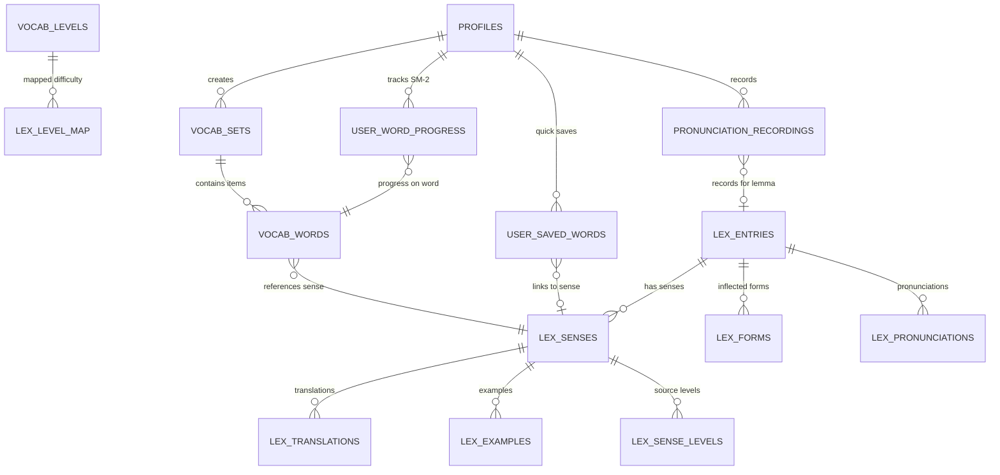

# LanguaLab Target Database Schema Specification (Future State Architecture)

> **Tài liệu đặc tả lược đồ cơ sở dữ liệu đích sau hợp nhất**  
> **Dự án:** LanguaLab (Cơ sở dữ liệu Từ vựng & Học tập Chuẩn hóa)  
> **Kiến trúc sư:** Senior Supabase / PostgreSQL Database Architect  
> **Trạng thái:** Thiết kế kiến trúc đích (Target Architecture Blueprint)

---

## 1. Tầm nhìn Kiến trúc Đích (Target Architecture Vision)

Hệ thống cơ sở dữ liệu đích của LanguaLab được tinh gọn, loại bỏ hoàn toàn các cấu trúc từ vựng phẳng và các bảng thử nghiệm thừa. Toàn bộ nền tảng chia sẻ một nguồn từ điển duy nhất (**Lexicon Core**), trong khi các tính năng cá nhân hóa (Flashcard, Học ngắt quãng SM-2, Ghi âm, Lưu từ) hoạt động như các lớp ứng dụng kết nối trực tiếp vào các thực thể ngữ nghĩa (`lex_senses`).



---

## 2. Làm rõ vai trò kiến trúc: `vocab_levels` và `lex_level_map`

Trong kiến trúc đích, mối quan hệ giữa `vocab_levels` và `lex_level_map` được định hình như sau:

1. **`vocab_levels` đóng vai trò là "Thang đo Độ khó Chuẩn 1–7 (Master Difficulty Dimension)":**
   - Thay vì gắn chặt vào một hệ thống khảo thí đơn lẻ (CEFR, HSK hoặc JLPT), LanguaLab định nghĩa một thang độ khó phổ quát từ 1 đến 7 dùng chung cho mọi ngôn ngữ:
     - Cấp 1: Cốt lõi A1 / HSK 1 / JLPT N5
     - Cấp 2: Sơ cấp A2 / HSK 2 / JLPT N4
     - Cấp 3: Tiền trung cấp B1 / HSK 3 / JLPT N3
     - Cấp 4: Trung cấp B2 / HSK 4 / JLPT N2
     - Cấp 5: Cao cấp C1 / HSK 5 / JLPT N1
     - Cấp 6: Thành thạo C2 / HSK 6
     - Cấp 7: Chuyên sâu & Hiếm gặp (vượt C2 / HSK 7-9)
   - Do đó, `vocab_levels` **KHÔNG PHẢI là bảng rác** cần xóa, mà là bảng Dimension cốt lõi.
2. **`lex_level_map` đóng vai trò là "Cầu nối Quy đổi (Transformation Bridge)":**
   - Bảng này ánh xạ từng cặp `(level_system, level)` (ví dụ `('cefr', 'B1')`, `('hsk', '3')`) về đúng `vocab_level_number (1..7)` tương ứng trong `vocab_levels`.
   - **Tùy chọn tương lai (Future Refactoring):** Nếu muốn bỏ hoàn toàn bảng `vocab_levels`, ta có thể chuyển `level_number` thành một cột kiểu số nguyên `INT CHECK (level_number BETWEEN 1 AND 7)` ngay trong `lex_level_map`. Tuy nhiên, việc duy trì bảng `vocab_levels` (7 dòng) hiện tại mang lại sự trong sáng cho database, giúp Frontend dễ dàng tải các nhãn hiển thị tiếng Việt (`title`, `description`, `color_tone`) mà không cần hard-code trên client.

---

## 3. Đặc tả Lược đồ DDL Chi tiết (Complete Target DDL Specifications)

### 3.1 Bảng Phân cấp & Ánh xạ Độ khó (Master Dimensions)

```sql
-- 1. Bảng 7 Cấp độ khó phổ quát
CREATE TABLE IF NOT EXISTS public.vocab_levels (
  id SERIAL PRIMARY KEY,
  level_number INTEGER NOT NULL UNIQUE CHECK (level_number BETWEEN 1 AND 7),
  code VARCHAR(10) NOT NULL UNIQUE,          -- 'A1', 'A2', 'B1', 'B2', 'C1', 'C2', 'C2+'
  title TEXT NOT NULL,                       -- 'Cốt lõi A1', 'Chuyên sâu & Hiếm gặp'...
  cefr_equivalent VARCHAR(20),               -- 'A1', 'A2', 'B1', 'B2', 'C1', 'C2', 'C2+ Expert'
  target_word_count INTEGER NOT NULL DEFAULT 500,
  color_tone VARCHAR(20) NOT NULL DEFAULT 'ok',
  description TEXT
);

-- 2. Bảng Ánh xạ cấp độ của từng hệ khảo thí về thang 1-7
CREATE TABLE IF NOT EXISTS public.lex_level_map (
  level_system TEXT NOT NULL CHECK (level_system IN ('cefr', 'hsk', 'jlpt', 'custom')),
  level TEXT NOT NULL,
  vocab_level_number INTEGER NOT NULL REFERENCES public.vocab_levels(level_number) ON DELETE RESTRICT,
  PRIMARY KEY (level_system, level),
  CONSTRAINT chk_lex_level_map_valid CHECK (public.lex_level_is_valid(level_system, level))
);
```

---

### 3.2 Bảng Bộ từ & Thẻ học tập Flashcard (Study Sets & Items)

```sql
-- 3. Bộ sưu tập thẻ từ học tập (Cá nhân hoặc Hệ thống)
CREATE TABLE IF NOT EXISTS public.vocab_sets (
  id UUID PRIMARY KEY DEFAULT gen_random_uuid(),
  user_id UUID REFERENCES public.profiles(id) ON DELETE CASCADE, -- NULL nếu là bộ đề xuất hệ thống
  level_id INTEGER REFERENCES public.vocab_levels(id) ON DELETE SET NULL,
  title TEXT NOT NULL CHECK (char_length(btrim(title)) > 0),
  description TEXT,
  is_system BOOLEAN NOT NULL DEFAULT FALSE,
  is_published BOOLEAN NOT NULL DEFAULT TRUE,
  language learning_language NOT NULL DEFAULT 'en',
  created_at TIMESTAMPTZ NOT NULL DEFAULT NOW(),
  updated_at TIMESTAMPTZ NOT NULL DEFAULT NOW()
);

-- 4. Thẻ từ trong bộ (Đã tích hợp liên kết ngữ nghĩa lex_sense_id)
CREATE TABLE IF NOT EXISTS public.vocab_words (
  id UUID PRIMARY KEY DEFAULT gen_random_uuid(),
  set_id UUID NOT NULL REFERENCES public.vocab_sets(id) ON DELETE CASCADE,
  lex_sense_id UUID REFERENCES public.lex_senses(id) ON DELETE SET NULL, -- CẦU NỐI CANONICAL
  word TEXT NOT NULL CHECK (char_length(btrim(word)) > 0),
  phonetic TEXT,
  part_of_speech VARCHAR(50),
  meaning_vi TEXT NOT NULL,
  example_sentence TEXT,
  example_translation TEXT,
  audio_url TEXT,
  created_at TIMESTAMPTZ NOT NULL DEFAULT NOW()
);

CREATE INDEX IF NOT EXISTS idx_vocab_words_set ON public.vocab_words(set_id);
CREATE INDEX IF NOT EXISTS idx_vocab_words_lex_sense ON public.vocab_words(lex_sense_id);
CREATE INDEX IF NOT EXISTS idx_vocab_words_word ON public.vocab_words(lower(word));
```

---

### 3.3 Bảng Tiến trình Ghi nhớ Lặp lại Ngắt quãng SM-2 (SRS Telemetry)

```sql
-- 5. Tiến trình lặp lại ngắt quãng SuperMemo SM-2
CREATE TABLE IF NOT EXISTS public.user_word_progress (
  id UUID PRIMARY KEY DEFAULT gen_random_uuid(),
  user_id UUID NOT NULL REFERENCES public.profiles(id) ON DELETE CASCADE,
  word_id UUID NOT NULL REFERENCES public.vocab_words(id) ON DELETE CASCADE,
  easiness_factor NUMERIC(4, 2) NOT NULL DEFAULT 2.50, -- Hệ số độ dễ SM-2
  repetition_count INTEGER NOT NULL DEFAULT 0,          -- Chuỗi số lần nhớ thành công liên tiếp
  interval_days INTEGER NOT NULL DEFAULT 1,             -- Khoảng cách ngày đến lần ôn kế tiếp
  correct_count INTEGER NOT NULL DEFAULT 0,
  incorrect_count INTEGER NOT NULL DEFAULT 0,
  last_reviewed_at TIMESTAMPTZ,
  next_review_at TIMESTAMPTZ NOT NULL DEFAULT NOW(),
  created_at TIMESTAMPTZ NOT NULL DEFAULT NOW(),
  updated_at TIMESTAMPTZ NOT NULL DEFAULT NOW(),
  CONSTRAINT uq_user_word UNIQUE (user_id, word_id)
);

CREATE INDEX IF NOT EXISTS idx_user_word_progress_due ON public.user_word_progress(user_id, next_review_at);
CREATE INDEX IF NOT EXISTS idx_user_word_progress_user ON public.user_word_progress(user_id);
```

---

### 3.4 Bảng Phụ trợ Cá nhân hóa (Auxiliary Learning Integrations)

```sql
-- 6. Danh sách từ lưu nhanh khi xem video hoặc đọc bài
CREATE TABLE IF NOT EXISTS public.user_saved_words (
  id UUID PRIMARY KEY DEFAULT gen_random_uuid(),
  user_id UUID NOT NULL REFERENCES public.profiles(id) ON DELETE CASCADE,
  lex_entry_id UUID REFERENCES public.lex_entries(id) ON DELETE SET NULL,
  lex_sense_id UUID REFERENCES public.lex_senses(id) ON DELETE SET NULL,
  word TEXT NOT NULL,
  phonetic TEXT,
  reading TEXT,
  meaning TEXT NOT NULL,
  source_type TEXT NOT NULL CHECK (source_type IN ('video', 'reading', 'dictionary', 'typing', 'grammar', 'manual')),
  source_ref TEXT,
  target_set_id UUID REFERENCES public.vocab_sets(id) ON DELETE SET NULL,
  context_sentence TEXT,
  created_at TIMESTAMPTZ NOT NULL DEFAULT NOW(),
  CONSTRAINT uq_user_saved_word UNIQUE (user_id, word, source_type, source_ref)
);

CREATE INDEX IF NOT EXISTS idx_user_saved_words_user ON public.user_saved_words(user_id, created_at DESC);
CREATE INDEX IF NOT EXISTS idx_user_saved_words_lex_sense ON public.user_saved_words(lex_sense_id);

-- 7. Bản ghi âm phát âm học viên
CREATE TABLE IF NOT EXISTS public.pronunciation_recordings (
  id UUID PRIMARY KEY DEFAULT gen_random_uuid(),
  user_id UUID NOT NULL REFERENCES public.profiles(id) ON DELETE CASCADE,
  word_id UUID REFERENCES public.vocab_words(id) ON DELETE SET NULL,
  lex_entry_id UUID REFERENCES public.lex_entries(id) ON DELETE SET NULL,
  word_text TEXT NOT NULL,
  audio_path TEXT NOT NULL,
  score NUMERIC(5, 2),
  feedback JSONB DEFAULT '{}'::jsonb,
  created_at TIMESTAMPTZ NOT NULL DEFAULT NOW()
);

CREATE INDEX IF NOT EXISTS idx_pronunciation_recordings_user ON public.pronunciation_recordings(user_id, created_at DESC);
CREATE INDEX IF NOT EXISTS idx_pronunciation_recordings_lex_entry ON public.pronunciation_recordings(lex_entry_id);
```

---

## 4. Các Khung nhìn Chuẩn hóa Mới (Modernized Canonical Views)

### 4.1 Khung nhìn `v_words_due_today` (SRS Due Words V2)

```sql
CREATE OR REPLACE VIEW public.words_due_today AS
SELECT
  p.id AS progress_id,
  p.user_id,
  p.next_review_at,
  p.repetition_count,
  p.easiness_factor,
  p.interval_days,
  w.id AS word_id,
  w.lex_sense_id,
  -- Lấy lemma và phát âm chuẩn từ kho Lexicon nếu có liên kết
  COALESCE(le.lemma, w.word) AS word,
  COALESCE(lp.transcription, w.phonetic) AS phonetic,
  COALESCE(ls.part_of_speech, w.part_of_speech) AS part_of_speech,
  COALESCE(lt.translated_text, w.meaning_vi) AS meaning_vi,
  COALESCE(lx.sentence, w.example_sentence) AS example_sentence,
  COALESCE(lx.sentence_vi, w.example_translation) AS example_translation,
  COALESCE(lp.audio_url, w.audio_url) AS audio_url,
  s.title AS set_title,
  CASE WHEN p.interval_days <= 1 OR p.incorrect_count > p.correct_count THEN true ELSE false END AS is_critical
FROM public.user_word_progress p
JOIN public.vocab_words w ON p.word_id = w.id
JOIN public.vocab_sets s ON w.set_id = s.id
LEFT JOIN public.lex_senses ls ON w.lex_sense_id = ls.id
LEFT JOIN public.lex_entries le ON ls.entry_id = le.id
LEFT JOIN public.lex_pronunciations lp ON lp.entry_id = le.id
LEFT JOIN public.lex_translations lt ON lt.sense_id = ls.id AND lt.review_status = 'approved'
LEFT JOIN public.lex_examples lx ON lx.sense_id = ls.id AND lx.review_status = 'approved'
WHERE p.next_review_at <= NOW();
```

---

## 5. Chiến lược Phân quyền Row Level Security (RLS Matrix)

| Bảng dữ liệu | Quyền SELECT Khách (`anon`) | Quyền SELECT Học viên (`authenticated`) | Quyền GHI Học viên (`authenticated`) | Quyền Quản trị viên (`admin`) |
|---|:---:|:---:|:---:|:---:|
| `vocab_levels` | Đọc công khai (`true`) | Đọc công khai (`true`) | Bị chặn (`false`) | Toàn quyền (`is_admin()`) |
| `lex_level_map` | Đọc công khai (`true`) | Đọc công khai (`true`) | Bị chặn (`false`) | Toàn quyền (`is_admin()`) |
| `vocab_sets` | Đọc: `is_system AND is_published` | Đọc: Hệ thống hoặc `user_id = auth.uid()` | Quản lý bộ của chính mình (`user_id = auth.uid()`) | Toàn quyền (`is_admin()`) |
| `vocab_words` | Kế thừa từ bộ hệ thống | Kế thừa từ bộ hệ thống / bộ của mình | Quản lý từ trong bộ của mình | Toàn quyền (`is_admin()`) |
| `user_word_progress` | Bị chặn | Chỉ xem tiến trình của mình (`user_id = auth.uid()`) | Bị chặn ghi trực tiếp (Chỉ cập nhật qua RPC `review_word`) | Quản lý / Hỗ trợ học viên |
| `user_saved_words` | Bị chặn | Chỉ xem từ đã lưu của mình | Quản lý từ lưu của mình | Quản trị viên |
| `pronunciation_recordings` | Bị chặn | Chỉ xem bản ghi âm của mình | Quản lý bản ghi âm của mình | Quản trị viên |
| `lex_*` (Canonical) | Đọc: Nội dung `published` & `approved` | Đọc: Nội dung `published` & `approved` | Bị chặn (Chỉ tạo báo cáo `lex_reports`) | Toàn quyền kiểm duyệt (`is_admin()`) |
